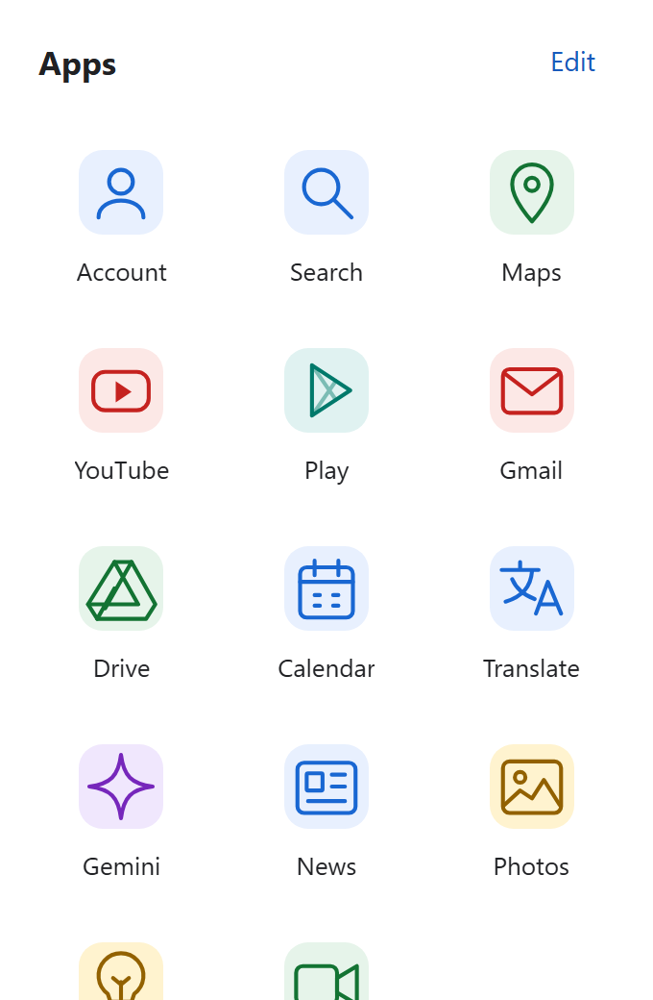
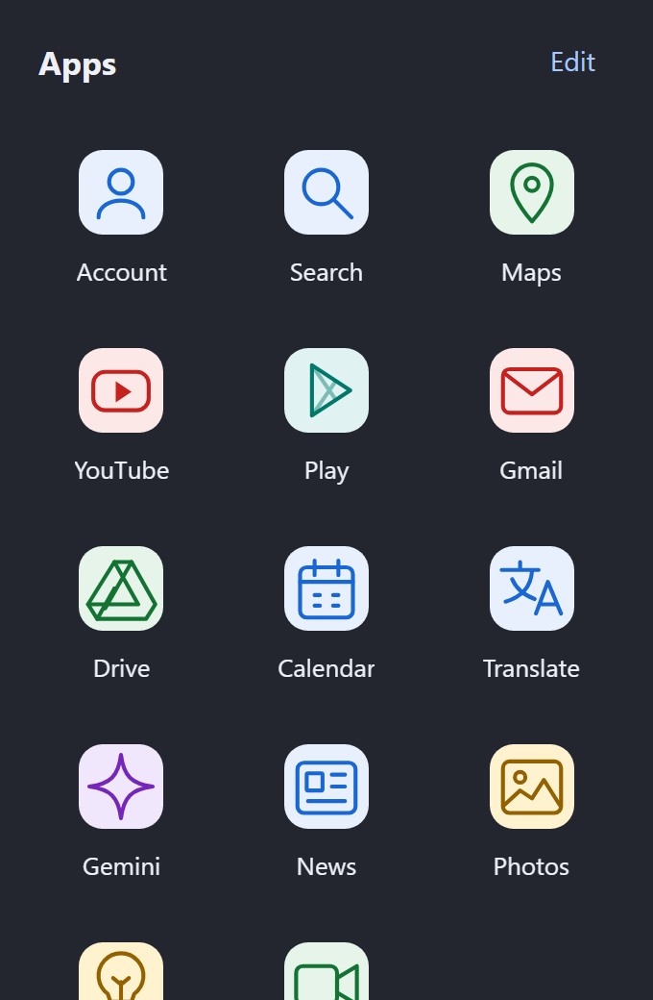

<div align="center">
  
  <h1>Hiratoco</h1>
  <p>よく使うWebアプリを、ツールバーから。</p>
  <p><a href="README.md">English</a> · <strong>日本語</strong></p>
</div>

Hiratoco（ヒラトコ）は、お気に入りのWebアプリやサイトをツールバーから開く拡張機能です。Firefoxと、Chrome・EdgeなどのChromium系ブラウザーに対応しています。初期登録のGoogleサービス14件をそのまま使うことも、自分のサイトを追加して並べ替えることもできます。

<p align="center">
  
  &nbsp;&nbsp;
  
</p>

## 自分の使いやすい一覧に

- **サイトと並び順を自由に。** 最大100件まで追加でき、名前の変更・削除・並べ替えに対応しています。サイトは新しいタブで開きます。
- **好きな画像をアイコンに。** 手元のPNG・JPEG・WebP画像を使えます。
- **ライトとダークを選択。** ブラウザーが伝えるシステム配色に合わせるほか、どちらかに固定できます。
- **日本語と英語に対応。** 初回はブラウザーの表示言語に合わせ、設定画面で好みの言語に変更できます。
- **キーボードでも操作。** Tabや矢印キーで選び、Enterで開き、Escapeで閉じます。

## Firefoxで試す

**v0.1.0はソースコードから利用できます。** Firefox Add-onsへの掲載と、署名済みファイルの配布はまだ行っていません。

1. [ソースコードをダウンロード](https://github.com/shuuuumai96/hiratoco/archive/refs/heads/main.zip)して展開するか、このリポジトリをcloneします。
2. Firefoxで `about:debugging#/runtime/this-firefox` を開きます。
3. **「一時的なアドオンを読み込む」** を選び、`extension/manifest.json` を指定します。
4. Hiratocoをツールバーにピン留めし、9点のアイコンから開きます。

ビルドは不要です。一時インストールはFirefoxを閉じると解除されます。継続して使うにはMozillaの署名済みXPIが必要です。署名の手順は[開発ガイド](docs/DEVELOPMENT.md#packaging-and-distribution)にまとめています。

最低対応バージョンはFirefox 142です。Windows版Firefox 158.0.1で検証しています。検証済みの範囲と残っている確認項目は[検証記録](TESTING.md)を参照してください。

## Chrome・Edgeで試す

Chromium版はChrome/Chromium 109以降を対象にしています。Chrome Web Store・Edge Add-onsへの掲載はまだ行っていません。製品版Chrome・Edgeでの手動確認は別途必要です。実行済みの検証は[検証記録](TESTING.md)を参照してください。

1. ソースコードをダウンロードまたはcloneし、Node.js 22以降とnpmを用意します。
2. リポジトリのディレクトリで次のコマンドを実行します。

   ```sh
   npm ci --ignore-scripts
   npm run package:chromium
   ```

3. Chromeでは `chrome://extensions`、Edgeでは `edge://extensions` を開き、**「デベロッパーモード」**を有効にします。
4. **「パッケージ化されていない拡張機能を読み込む」**を選び、生成された `dist/chromium/` を指定します。
5. Hiratocoをツールバーにピン留めし、9点のアイコンから開きます。

読み込んだディレクトリは削除せずに保持してください。ソースを変更したら `npm run package:chromium` を再実行し、ブラウザーの拡張機能管理画面で再読み込みします。Chromium版はシークレット・InPrivateウィンドウでは利用できません。

## サイトを登録する

ランチャー右上の**「編集」**から、サイトの追加、名前やアイコンの変更、配色・表示言語の設定ができます。登録できるURLはHTTPSのみです。

行をドラッグすると並べ替えられます。「上へ」「下へ」ボタンのほか、行にフォーカスして **Alt + ↑ / ↓** でも移動できます。変更は現在のブラウザープロファイルに保存されます。

初回はブラウザーが日本語なら日本語、それ以外なら英語で表示します。設定画面で言語を選ぶと、その選択を優先します。自分で付けたサイト名は翻訳せず、そのまま表示します。

## プライバシー

要求する権限は `storage` のみです。ページの内容、閲覧履歴、Cookie、開いているタブの一覧は読み取りません。広告・アクセス解析・外部スクリプト・アイコンの自動取得もありません。

登録したサイト・設定・画像はブラウザープロファイル内に保存します。ブラウザー間の同期や外部バックアップは行いません。サイトを開いた後は、通常の閲覧と同じようにブラウザーがそのサイトへ接続します。

保存の上限、データの削除、破損時の修復については[データと復旧の説明（英語）](docs/DATA.md)を参照してください。

## 開発する

Node.js 22以降とnpmが必要です。

```sh
npm ci --ignore-scripts
npm test
npm run lint
npm run package
npm run package:chromium
```

Firefox用には未署名の `dist/hiratoco-0.1.0.zip` を生成します。Chromium用のコマンドは `dist/hiratoco-chromium-0.1.0.zip` と、読み込み用ディレクトリ `dist/chromium/` を生成します。

- [開発ガイド（英語）](docs/DEVELOPMENT.md)：ブラウザーテスト、梱包、更新の手順。
- [検証記録](TESTING.md)：実行結果と未確認の項目。
- [画像の出典とライセンス](ASSETS.md)：同梱アイコンの利用条件。

不具合はブラウザー名・バージョン・再現手順を添えて[Issue](https://github.com/shuuuumai96/hiratoco/issues)へ報告してください。私的なURLや画像は含めないでください。

## ライセンス

[MIT](LICENSE)。Hiratocoは個人が開発する拡張機能で、Google・Mozilla・Microsoftの公式製品ではありません。
